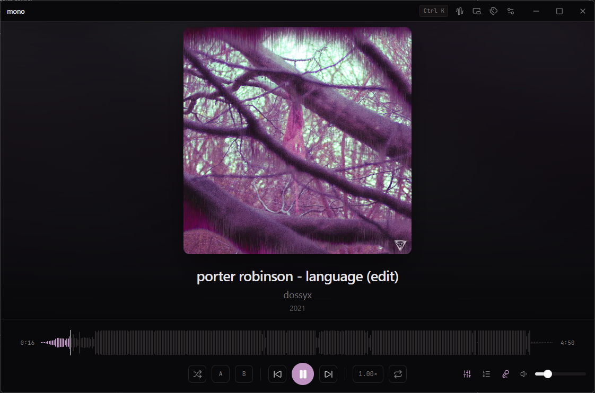
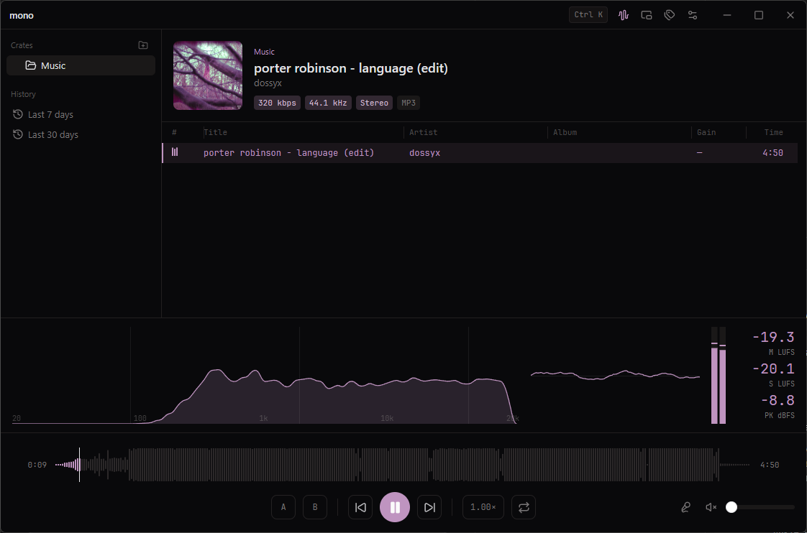
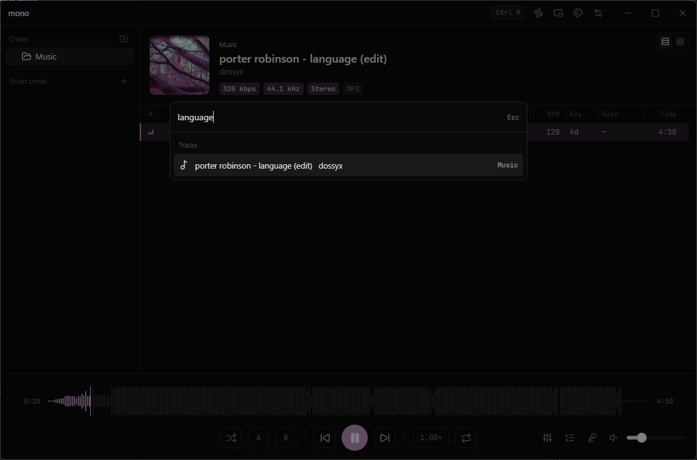

<h1 align="center">mono</h1>

  A fast, quiet music player for the files you already have. 
  <a href="https://github.com/shybruh/mono/releases/latest"><b>Download for Windows, macOS or Linux</b></a>

  

## Features

- **Your folders are your library.** Add a folder; its sub-folders and playlists appear as crates. No importing, and changes on disk show up on their own. Untagged files get their artist and title from the file name, with optional online lookup for albums and cover art.
- **Gapless and even.** Mixes and live albums play without gaps, and loud and quiet tracks play at the same level (ReplayGain).
- **Waveform seek bar, A–B loop, and separate speed and pitch control** for learning parts or digging into a section.
- **Theater mode and synced lyrics** (`F`), fullscreen with `F11`.
- **Search everything** with `Ctrl+K`.
- **Meters:** spectrum, oscilloscope, peak and loudness, on `V`.
- **Mini player** that stays on top (`M`) and scales as you resize it.
- **Themes**, including frosted glass and your own colours; the accent can follow the album art.
- **Tag and cover-art editing**, listening history, optional Discord status, and automatic updates.

Plays MP3, FLAC, WAV, OGG and M4A/AAC.

<table>
  <tr>
    <td></td>
    <td></td>
  </tr>
  <tr>
    <td></td>
    <td></td>
  </tr>
</table>

## How light is it?

Same MP3 in every player, Ryzen 7 5700X3D, Windows 11:

| | Opens in | Memory | CPU | Size |
| --- | ---: | ---: | ---: | ---: |
| **mono** | **73 ms** | 141 MB | 0.28 % | **9 MB** |
| AIMP | 687 ms | 22 MB | 0.23 % | 72 MB |
| VLC | 299 ms | 25 MB | 0.24 % | 172 MB |
| Spotify | 973 ms | 844 MB | 3.33 % | 504 MB |

Memory and CPU while playing (Spotify: idle, as it can't open local files on command). Run it yourself with <a href="scripts/bench.ps1"><code>scripts/bench.ps1</code></a>.

## Shortcuts

`Space` play/pause · `←` `→` seek (`Shift` for 30 s) · `N` `P` next/previous · `[` `]` `\` loop A/B/clear · `0` reset speed and pitch · `R` repeat · `F` theater · `F11` fullscreen · `V` visualiser · `M` mini player · `T` tags · `Ctrl+K` search · `Ctrl+,` settings

## Notes

Builds aren't signed with a paid certificate, so Windows may show a SmartScreen prompt on first install (*More info → Run anyway*). Building from source: [docs/DEVELOPMENT.md](docs/DEVELOPMENT.md). Changes: [CHANGELOG.md](CHANGELOG.md).

**AI disclosure:** Mono was built with help from AI models, Claude Opus 5.5 (Anthropic) and Qwen 3.8 (Alibaba), used for writing code and documentation.

**License:** [MIT](LICENSE). Includes [Signalsmith Stretch](https://github.com/Signalsmith-Audio/signalsmith-stretch) (MIT).
