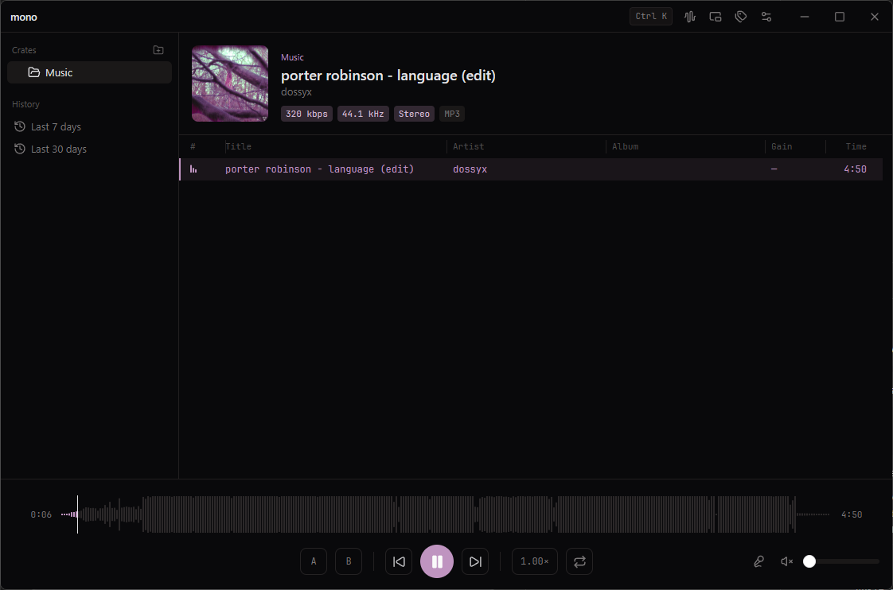
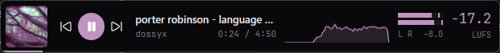

<h1 align="center">mono</h1>

  A fast, quiet music player for the files you already have. 
  Point it at your folders and press play.

  <a href="https://github.com/shybruh/mono/releases/latest"><b>Download</b></a> ·
  <a href="#what-it-does">What it does</a> ·
  <a href="#how-light-is-it">How light is it?</a> ·
  <a href="#shortcuts">Shortcuts</a>

  

---

## What it does

### Your folders are your library

No importing, no scanning screens, no database to babysit. Add a folder and its sub-folders and playlists show up as **crates** straight away. Rename, move or add files and Mono notices on its own.

Files without tags still look right: Mono reads the artist and title from names like `Artist - Title.mp3`, and can fetch missing album info and cover art for you.

### Music that flows

- **Gapless playback.** Live albums and DJ mixes run from track to track without a single dropped beat.
- **Even volume.** Loud modern masters and quiet old rips play at the same level (ReplayGain).
- **A waveform you can see.** The seek bar is the song's actual shape, so you can jump straight to the drop.
- **Loop and slow down.** Set an A–B loop on any section and change speed and pitch independently, great for learning a part or digging into a break.
- **Real file details.** Bitrate, sample rate, channels and format sit right under the title, no digging through properties.

### Lyrics and theater mode

Press `F` for a big, calm view of the cover art with synced lyrics that follow along (from `.lrc` files, your tags, or [LRCLIB](https://lrclib.net) if you turn it on). Click any line to jump there. Press `F11` to go fullscreen.

### Find anything from the keyboard

`Ctrl+K` opens a search box for every track, folder and action. Type a few letters, hit Enter, done.

### Meters, if you like that sort of thing

A spectrum analyser, oscilloscope, peak meters and loudness (LUFS) readouts, open with `V` and gone again when you don't need them.

### A tiny player that stays on top

Press `M` and Mono shrinks into a slim always-on-top strip you can park anywhere. Resize it and everything scales; right-click to choose which meters to show.

### Make it yours

- **Themes:** Zinc, Paper, Phosphor, Amber, frosted Glass and Frost, or pick your own colours. The accent can follow each album's cover art.
- **Fix tags in place:** edit titles, artists, track numbers and cover art from a side drawer, or look them up online.
- **Discord:** optionally show what you're listening to.
- **Listening history:** see what you played in the last week or month.
- **Updates itself** when a new version is out.

---

## How light is it?

Measured on one PC (Ryzen 7 5700X3D, 32 GB, Windows 11), every player playing the same MP3:

| | Opens in | Memory while playing | CPU while playing | Size on disk |
| --- | ---: | ---: | ---: | ---: |
| **mono** | **73 ms** | 141 MB | 0.28 % | **9 MB** |
| AIMP | 687 ms | 22 MB | 0.23 % | 72 MB |
| VLC | 299 ms | 25 MB | 0.24 % | 172 MB |
| Spotify | 973 ms | 844 MB&nbsp;(idle) | 3.33 %&nbsp;(idle) | 504 MB |

Mono opens fastest and is the smallest download, uses about a sixth of Spotify's memory, and sits as idle as the classic players once it's playing. It uses more memory than AIMP or VLC because its interface is drawn with the browser engine built into Windows.

"Opens in" is the time until the window appears. CPU is a share of the whole processor. Spotify can't play a local file on command, so its numbers are idle. Run it yourself with [`scripts/bench.ps1`](scripts/bench.ps1); raw results in [`docs/bench-results.json`](docs/bench-results.json).

---

## Shortcuts

| Key | Action |
| --- | --- |
| `Space` | Play / pause |
| `←` `→` | Seek 5 s (hold `Shift` for 30 s) |
| `↑` `↓` `Enter` | Pick a track and play it |
| `N` `P` | Next, previous |
| `[` `]` `\` | Loop start, loop end, clear loop |
| `0` | Reset speed and pitch |
| `R` | Repeat off / all / one |
| `F` | Theater mode and lyrics |
| `F11` | Fullscreen |
| `V` | Visualiser |
| `M` | Micro-deck |
| `T` | Edit tags |
| `Ctrl+K` or `/` | Search everything |
| `Ctrl+,` | Settings |

---

## Get it

Grab the installer for Windows, macOS or Linux from the [latest release](https://github.com/shybruh/mono/releases/latest). Mono keeps itself up to date after that.

Builds aren't signed with a paid certificate yet, so Windows may show a SmartScreen prompt the first time (*More info → Run anyway*).

Plays MP3, FLAC, WAV, OGG and M4A/AAC.

Building it yourself or curious how it works? See [docs/DEVELOPMENT.md](docs/DEVELOPMENT.md). Changes are listed in [CHANGELOG.md](CHANGELOG.md). Includes [Signalsmith Stretch](https://github.com/Signalsmith-Audio/signalsmith-stretch) (MIT).
